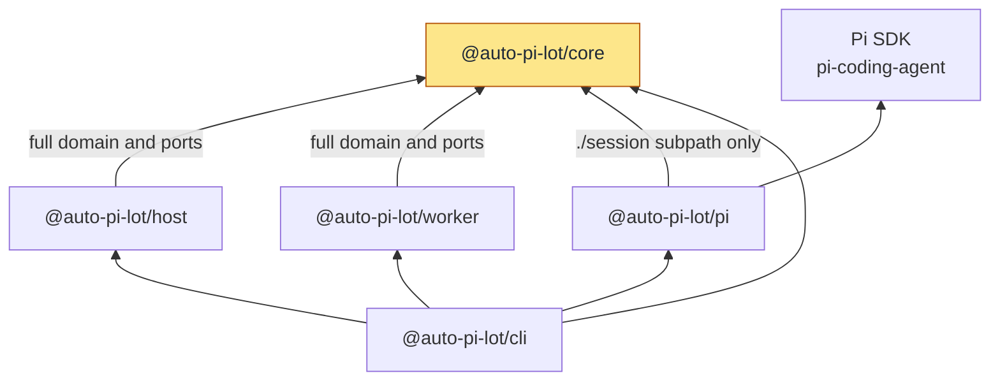
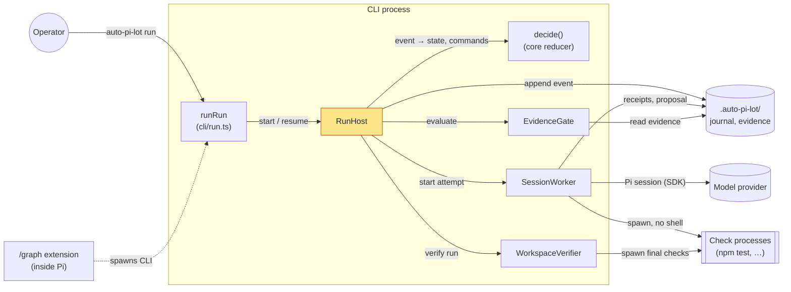
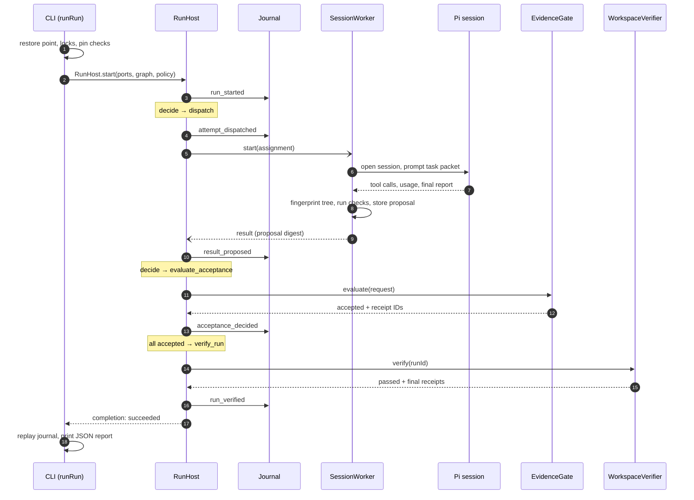
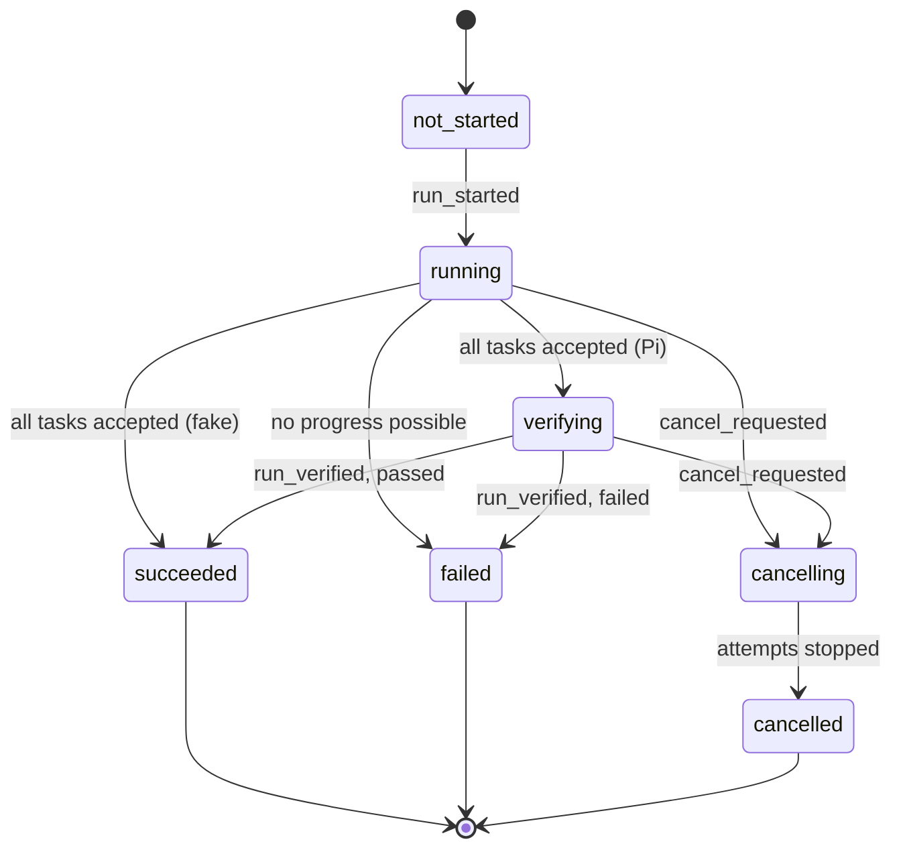

# Architecture

**In short.** Today auto-pi-lot is five small packages: `core` makes the decisions (it checks
plans and decides what should happen next in a run), `host` drives those decisions against
pluggable *ports* (the event log, the workers, the evidence store and the acceptance gate) and
judges results from recorded evidence, `worker` runs one attempt at a time through a coding
session in your repository and runs your checks, `pi` connects to Pi sessions, and `cli` wires
it all together. A plan runs end to end with real Pi sessions (`run --worker pi`) or with the
fake worker, is journaled and survives a restart. The code is split so that the decision-making
part (`core`) can never reach into the Pi-specific part or into any effect, and the linter
checks this on every change. [Architecture: What runs today, Packages]

*About this page.* It is a plain-language edition of the architecture page for engineers and
engineering leads who want to understand what the code does today and how it is organised,
without knowing its internals. Code names are kept in `code font` so the page still maps onto
the source. Bracketed references such as [Architecture: State] point to the section of the
original document this edition was rewritten from; the originals are in the Git history at
commit `bf04bd0`. Terms in *italics* on first use are defined in the [glossary](#glossary).
For the finished product see the [design document](design.md); for progress see the
[roadmap](roadmap.md).

## What runs today

- **Plan checking.** A plan (*task graph*) arrives as untrusted data. It is read strictly
  against a schema, then checked for meaning. The result is either a `ValidatedGraph`, a type
  that only the checker can produce, or a list of every problem found, each with a typed
  reason. [Architecture: What runs today]
- **The run reducer.** `decide(state, event) → { state, commands, rejection? }` is the one
  function that decides how a run proceeds. It is *pure* (it only computes; it has no side
  effects) and *total* (it returns an answer for every possible input). It currently handles
  a single, flat plan, meaning no task starts a sub-plan. It covers: reserving a slot before
  starting an attempt, under a limit on how many run at once; a bounded number of retries;
  the two kinds of dependency ("needs a result" and "needs an accepted result");
  *fencing tokens*; the host's acceptance decisions; and cancellation. `replay(events)` runs
  a saved sequence of events through `decide` to rebuild the state. When a task runs out of
  attempts, the tasks waiting on it are marked failed rather than left waiting
  (decision 0006). An
  "accepted" decision must cite at least one receipt, or the reducer rejects it. [Architecture: What runs
  today]

  A task whose result other tasks check is accepted only after every checking task has an
  accepted result for that exact attempt. A failing finding rejects the task that produced the
  result: its next attempt names the rejection it repairs, and everything built on the
  rejected result is stopped or set back to waiting
  (decision 0005,
  decision 0007). How receipts turn into
  that finding is still the host's job.
- **The host.** `RunHost` (`packages/host`) is the loop the reducer protocol below describes:
  it parses each event, runs `decide`, appends the event to a *journal store*, and only then
  carries out the commands: it starts an attempt on the *worker port*, asks the *acceptance
  gate* for a decision, or cancels an attempt. Worker outcomes and gate verdicts come back as
  new events the host writes itself. `RunHost.resume` rebuilds a run from its journal by
  replay and then reconciles what was in flight (decision
  0008). The package ships an in-memory
  journal, a file journal (one append-only JSON Lines file per run) and scripted fakes for the
  worker and the gate, so the whole path runs without a model. [Architecture: What runs today]
- **Session interface and Pi adapter.** `CodingSession` is the interface through which the
  rest of the system talks to an AI coding session. It knows nothing about any particular
  model provider. `openPiSession` implements it on top of the pinned version of the Pi
  software development kit (SDK) and translates Pi's events into neutral ones.
  [Architecture: What runs today]
- **Evidence and the evidence gate.** `host` also stores evidence records (proposals, check
  receipts, review receipts, acceptance records) and artifacts (check logs) in content-addressed
  stores, and `EvidenceGate` answers the reducer's acceptance requests from those records
  alone: required checks must have passed against the exact tree the proposal names, no review
  of the candidate may have failed, and a checker's own attempt is accepted when its review is
  not unclear (decision 0010).
- **The session worker.** `SessionWorker` (`packages/worker`) runs one attempt: it builds a
  task packet from the node, the results it consumes and any rejection it repairs, opens a
  closed coding session with the tools its role allows, enforces the node's tool-call and token
  limits, reads the model's final report, fingerprints the workspace, runs the node's declared
  checks itself (no shell, environment allowlist, timeout) and stores the evidence. The CLI requires serial attempts for Pi so checks and reviews cannot overlap edits,
  and holds filesystem ownership locks across the run (decision 0013). It is in-process, not a
  sandbox (decision 0012).
- **Pi session opener.** `createPiSessionOpener` (`packages/pi`) pins the model route and opens
  a closed Pi session per attempt: transcript in memory, or in the run's session directory
  when the CLI asks for it (decision 0015), no extensions or skills, the worker's tool
  allowlist and system prompt, SDK retries off.
- **Pi extension.** `/graph run|resume|cancel|status|inspect` drive the command-line tool as a
  child process (one run at a time per extension instance; no shell, no import of the CLI
  package), showing progress in a widget. `/graph on|off|pause` need the background supervisor
  and are not available.
- **Command-line tool.** `init` writes a starter `auto-pi-lot.json` (check profiles discovered
  from `package.json` scripts, as data) and an example plan for the repository. `validate`
  checks a plan file and lists its issues, warnings, task order and ready tasks. `run` executes
  a plan through the host: with `--worker pi` on your repository with real sessions and your
  checks, otherwise with the fake worker and gate. `inspect` shows a run's state and evidence,
  `status` lists runs, `artifact` prints a stored log. `check` runs baseline profiles without a
  model; `run --dry-run` previews validated configuration without writes or model setup. `demo` prints the example plan and
  `trace` runs four scripted scenarios through the real reducer for the
  [trace viewer](https://sebastianspicker.github.io/auto-pi-lot/) (`site/`). [Architecture:
  What runs today]

The actions on the outside world are the host's journal, evidence and artifact writes, the
worker's check processes, and the model calls made through the Pi session the `cli` composes.
Everything else exists as the reducer's *commands* (instructions for the host) and as the
ports the host is given. [Architecture: What runs today]

## Packages

| Package | Responsible for | May use |
| --- | --- | --- |
| [`@auto-pi-lot/core`](../packages/core/README.md) | The deterministic, provider-neutral core: data formats on the wire and their canonical identities, the plan format and its checking, the vocabulary of run states, journal events, the reducer and replay, evidence records, and the session interface | `zod` (a schema library) and `node:crypto` |
| [`@auto-pi-lot/host`](../packages/host/README.md) | The host loop (`RunHost`), the journal, evidence and artifact stores, the evidence gate, and the scripted fake worker and gate | `@auto-pi-lot/core` and Node's file system |
| [`@auto-pi-lot/worker`](../packages/worker/README.md) | The session worker, the check runner, the workspace fingerprint and the task packet | `@auto-pi-lot/core` and Node's file system and child processes |
| [`@auto-pi-lot/pi`](../packages/pi/README.md) | Everything tied to the Pi SDK: the session adapter, the session opener and the Pi extension entry point | Only the session part of core (`@auto-pi-lot/core/session`), and the Pi SDK |
| [`@auto-pi-lot/cli`](../packages/cli/README.md) | The operator's entry point (`init`, `validate`, `check`, `run`, `inspect`, `status`, `artifact`, `demo`, `trace`) and the place where the parts are wired together | `@auto-pi-lot/core`, `@auto-pi-lot/host`, `@auto-pi-lot/worker`, `@auto-pi-lot/pi` |

Which package may import which (arrows point from the importer to what it imports):

All dependencies point toward `core`, and `core` depends on no other package in the
repository. No package uses `cli`, and `host`, `worker` and `pi` do not use each other: the
worker is handed a session opener and stores, it never imports them. Because `pi` can only see
the session interface, code tied to the Pi SDK cannot reach into run decisions, and because
`core` cannot import `host`, the reducer cannot reach the file system. [Architecture: Packages]

### How the rules are enforced

Each rule is checked automatically by the Biome linter when `npm run lint` runs, so a
violation fails the build rather than depending on review. [Architecture: Enforcement]

| Rule | Checked by |
| --- | --- |
| A package may only use libraries declared in its own `package.json`. Only `pi` declares the Pi SDK, and no package declares `cli`. | Biome `noUndeclaredDependencies` |
| Code in `core/src` may only use `zod`, `node:crypto` and its own files. | Biome `noRestrictedImports`, set for `packages/core/src` |
| Code in `host/src` may only use `@auto-pi-lot/core`, the Node built-ins `crypto`, `fs` and `path`, and its own files. | Biome `noRestrictedImports`, set for `packages/host/src` |
| Code in `worker/src` may only use `@auto-pi-lot/core`, the Node built-ins `child_process`, `crypto`, `fs`, `os` and `path`, and its own files. | Biome `noRestrictedImports`, set for `packages/worker/src` |
| `pi` uses `@auto-pi-lot/core/session`, never the whole of `@auto-pi-lot/core`. | Biome `noRestrictedImports`, set for `packages/pi` |
| No circular imports, including type-only ones and ones across packages. | Biome `noImportCycles` (`ignoreTypes: false`) |
| No file may reach directly into another package's `src` or `dist` folder. TypeScript's project references would otherwise quietly allow this. | Biome `noRestrictedImports`, set for `packages/*/src` and repeated in the `core` and `pi` settings, because a package-specific setting replaces the general one |

## How a run works

This section follows one `auto-pi-lot run --worker pi` from the command line to the final
report. The fake worker (`npm run fake-run`) takes the same path through `RunHost` and the
reducer, but swaps `SessionWorker` and `EvidenceGate` for `ScriptedWorker` and `ScriptedGate`
and skips final verification.

### What runs where

Everything except the model and the check commands runs in **one Node process**, the CLI:

`runRun` is the composition root: it builds the stores, the Pi session opener, the worker,
the gate and the verifier and hands them to `RunHost` as `HostPorts`. `RunHost` is the only
thing that talks to the reducer and the journal. The worker opens the Pi session in-process
through `createPiSessionOpener` (`packages/pi`); the model's own `bash` tool calls and the
check commands are the only child processes. The `/graph` extension never imports the CLI; it
starts it as a child process and reads its output. Before the first attempt, the CLI also runs
`git` to record a restore point (see [Runtime state](#runtime-state-on-disk)).

Where in the code:
[packages/cli/src/run.ts](../packages/cli/src/run.ts) (`runRun`),
[packages/host/src/host.ts](../packages/host/src/host.ts) (`RunHost`),
[packages/core/src/run/decide.ts](../packages/core/src/run/decide.ts) (`decide`),
[packages/worker/src/session-worker.ts](../packages/worker/src/session-worker.ts),
[packages/host/src/gate.ts](../packages/host/src/gate.ts),
[packages/worker/src/run-verifier.ts](../packages/worker/src/run-verifier.ts),
[packages/pi/src/opener.ts](../packages/pi/src/opener.ts),
[packages/pi/src/extension.ts](../packages/pi/src/extension.ts).

### What happens when you run a plan

One task, accepted on its first attempt, then final verification. Every arrow into `Journal`
is an event that `RunHost` first ran through `decide`; the reducer's commands are what make
the host take the next step.

- **Steps 1–2.** Before any session opens, the CLI takes the workspace and journal locks,
  records a git restore point and pins the check definitions into the execution manifest
  (decision 0016). `RunHost.start` validates the graph again.
- **Steps 3–5.** The host persists before acting (decision 0008): the worker starts only after
  `attempt_dispatched` is in the journal, so a crash at any point leaves an event log that
  `RunHost.resume` can replay and reconcile.
- **Steps 6–9.** The worker builds the task packet, opens a closed Pi session with the tools
  for the node's role, counts tool calls and tokens against the node's limits, and parses the
  final JSON report (one repair prompt if it is malformed). It then fingerprints the
  workspace, runs the node's checks as processes and writes check receipts and a
  `ResultProposal` to the evidence store. A reviewer node writes a review receipt instead of
  running checks.
- **Steps 11–13.** The model's report is only a proposal. `EvidenceGate` reads the evidence
  store and accepts only receipts reachable from the journaled proposal digest, then writes
  an `AcceptanceRecord` (decision 0010). A rejection makes the reducer dispatch a new attempt
  that names the receipts it must repair, up to `maxAttemptsPerNode`.
- **Steps 14–18.** With every task accepted, the reducer moves the run to `verifying`.
  `WorkspaceVerifier` reruns the declared checks on the combined tree; `run_verified` decides
  the final status (decision 0014). The JSON report goes to stdout; progress lines go to stderr.

Where in the code:
[packages/cli/src/restore.ts](../packages/cli/src/restore.ts) (`createRestorePoint`),
[packages/cli/src/lock.ts](../packages/cli/src/lock.ts),
[packages/worker/src/packet.ts](../packages/worker/src/packet.ts) (`buildTaskPacket`),
[packages/worker/src/tools.ts](../packages/worker/src/tools.ts) (tools per role),
[packages/worker/src/check-runner.ts](../packages/worker/src/check-runner.ts) (`runCheck`),
[packages/worker/src/workspace.ts](../packages/worker/src/workspace.ts) (fingerprint),
[packages/core/src/run/events.ts](../packages/core/src/run/events.ts) (event types),
[packages/core/src/run/commands.ts](../packages/core/src/run/commands.ts) (command types).

### Run states

The states a run goes through, as the reducer sets them in `RunState.status`:

"No progress possible" covers a task that ran out of attempts and everything that depends on
it (decision 0006). Pi runs always set `requireFinalVerification`, so they pass through
`verifying`; fake runs go straight to `succeeded`. Cancellation waits until no attempt holds a
permit and no verification is outstanding. Individual attempts have their own statuses
(`dispatched`, `result_ready`, `accepted`, `rejected`, `superseded`, …), documented on
`AttemptStatus`.

Where in the code: [packages/core/src/run/state.ts](../packages/core/src/run/state.ts)
(`RunStatus`, `AttemptStatus`), `checkCompletion` and `handleRunVerified` in
[packages/core/src/run/decide.ts](../packages/core/src/run/decide.ts).

### Runtime state on disk

All state a run leaves behind, relative to the workspace. Nothing here is committed to Git.

| Location | Holds | Written by |
| --- | --- | --- |
| `auto-pi-lot.json`, `auto-pi-lot.plan.json` | Check profiles, policy, model; the plan | `init`, then you |
| `.auto-pi-lot/journal/run-<runId>.jsonl` | The append-only event log, the source of truth for a run | `FileJournalStore` |
| `.auto-pi-lot/evidence/run-<runId>/<kind>-<hex>.json` | Proposals, check and review receipts, acceptance records, content-addressed | `FileEvidenceStore` |
| `.auto-pi-lot/artifacts/<hex>` | Check logs, content-addressed | `FileArtifactStore` |
| `.auto-pi-lot/sessions/run-<runId>/*.jsonl` | Pi session transcripts, one per attempt | Pi, via the session opener |
| `.auto-pi-lot/run.lock`, `<journal>/.writer.lock` | Workspace and journal ownership (PID, host, start time) | CLI lock |
| `refs/auto-pi-lot/restore/<runId>` (git ref) | A commit of the tree before the first attempt | `createRestorePoint` |

Run IDs are encoded into file names by `encodeRunId`. The whole `.auto-pi-lot/` directory is
excluded from the workspace fingerprint, so writing state never looks like a source change.

Where in the code:
[packages/cli/src/paths.ts](../packages/cli/src/paths.ts) (`runtimePaths`, the one place this
layout is spelled out),
[packages/host/src/journal/file.ts](../packages/host/src/journal/file.ts),
[packages/host/src/evidence/file.ts](../packages/host/src/evidence/file.ts),
[packages/host/src/paths.ts](../packages/host/src/paths.ts) (`encodeRunId`).

## Code map

In the order a newcomer would read it:

| Path | Responsibility |
| --- | --- |
| [packages/cli/src/index.ts](../packages/cli/src/index.ts) | Command dispatch: `init`, `validate`, `check`, `run`, `inspect`, … |
| [packages/cli/src/run.ts](../packages/cli/src/run.ts) | `runRun`: loads config and plan, wires the ports, starts or resumes the host, prints the report |
| [packages/core/src/graph/](../packages/core/src/graph) | Plan schema (`spec.ts`), checking (`validate.ts`) and warnings (`lint.ts`) |
| [packages/core/src/run/decide.ts](../packages/core/src/run/decide.ts) | The reducer: every scheduling, retry, acceptance and cancellation decision |
| [packages/core/src/run/ports.ts](../packages/core/src/run/ports.ts) | The interfaces the host is given: journal, worker, gate, evidence, artifacts, verifier |
| [packages/host/src/host.ts](../packages/host/src/host.ts) | `RunHost`: decide, persist, then act; resume and reconcile |
| [packages/host/src/gate.ts](../packages/host/src/gate.ts) | `EvidenceGate`: accept or reject from recorded evidence |
| [packages/worker/src/session-worker.ts](../packages/worker/src/session-worker.ts) | `SessionWorker`: one attempt through a coding session, then checks and proposal |
| [packages/worker/src/check-runner.ts](../packages/worker/src/check-runner.ts) | Runs one check profile as a process: no shell, env allowlist, timeout, logs |
| [packages/core/src/session.ts](../packages/core/src/session.ts) | `CodingSession`, the provider-neutral session interface |
| [packages/pi/src/opener.ts](../packages/pi/src/opener.ts) | Opens a closed Pi SDK session per attempt; `map-event.ts` translates its events |
| [packages/pi/src/extension.ts](../packages/pi/src/extension.ts) | The `/graph` commands inside Pi |
| [packages/host/src/fakes.ts](../packages/host/src/fakes.ts) | `ScriptedWorker` and `ScriptedGate` for runs without a model |
| [packages/cli/src/trace.ts](../packages/cli/src/trace.ts), [site/](../site) | Scripted scenarios and the trace viewer they feed |

## How the host uses the reducer

The reducer decides; the *host* acts. *Journal events* (defined in `core/src/run/events.ts`)
are versioned data formats. The host creates and timestamps them; they never come from model
output. Commands (`core/src/run/commands.ts`) are requests for actions. The host is expected
to work in this order [Architecture: The reducer protocol]:

1. **Check the input.** Parse every incoming event with `parseJournalEvent`; `decide` only
   ever receives checked events.
2. **Decide.** Apply the event with `decide`. If it is rejected, the state stays exactly as it
   was and the event is not saved as progress. Reasons for rejection include a stale fencing
   token, a duplicate, the wrong run, a run that has already ended, and a transition that is
   not allowed from the current state.
3. **Save, then act.** Save the accepted event first, then carry out the commands it produced.
   A `dispatch` (start an attempt) may only happen after its `attempt_dispatched` event has
   been applied without rejection.
4. **Report back as events.** The results of actions come back only as new events:
   `result_proposed`, `attempt_failed`, `lease_expired`, `attempt_stopped` and
   `acceptance_decided`.

Recovery after a crash means replaying the saved event log, then reconciling any actions that
were in progress (decision 0001). `RunHost` does
exactly this: an attempt that was still running belonged to a worker the dead process owned,
so it is journaled as `lease_expired` and retried under a new fencing token; a reservation
whose `attempt_dispatched` never reached the journal is dispatched again; an acceptance that
was requested but never decided is asked for again (decision
0008). A worker's result is only a proposal:
only an `acceptance_decided` event, produced by the host's *acceptance gate*, can change a
result to `accepted`. [Architecture: The reducer protocol]

## State

The event log (*journal*) is the source of truth and the run's state is derived from it. The
host's file journal is an interim store, one append-only JSON Lines file per run; the storage
decision of work package AP-04 will replace it behind the same `JournalStore` port. State is
plain data that can be written as JSON, so replaying events and comparing states give exact
results. Two version
numbers are kept separate: a *graph revision* is the history of a plan's content, and
`schemaVersion` is the version of the data format. [Architecture: State]

## Where new code goes

- **Deterministic decisions** go into `core`: in `graph/` if they concern the plan itself, or
  in `run/` if they concern carrying it out. Examples are scheduling, budgets, nested plans and
  repair loops. They extend the one existing reducer; there must not be a second state
  machine.
- **Actions on the outside world** (*effects*), such as SQLite storage, worker processes,
  worktrees, the command broker and the supervisor, go into packages that depend on `core`:
  `host` for the loop, the journal and the evidence, `worker` for running attempts and checks,
  new packages for the rest. Each such package is created together with its first real
  implementation, not in advance.
- **Interfaces to those effects** (*ports*) are added to `core` in the same change as their
  first implementation, and shaped by what the reducer and that implementation actually need.
  `core/src/run/ports.ts` holds `JournalStore`, `WorkerPort`, `AcceptanceGate`, `EvidenceStore`
  `ArtifactStore` and `RunVerifier`; `host` implements the storage and gate ports, `worker`
  implements `WorkerPort` and `RunVerifier`; `CodingSession` in `core/src/session.ts` is implemented by `pi`.
- **Use of the Pi SDK** goes into `pi`. The extension moves into its own package once it gains
  a supervisor client with different dependencies.
- **Wiring the parts together** goes into `cli`. [Architecture: Where new code goes]

## Repository tooling

`npm run check` runs the build, Biome (formatting, lint and the package rules above) and the
Markdown link checker. `npm test`, `npm run test:types` and `npm run sim` run the versioned
unit/integration tests, their type check and the seeded reducer simulation. The `scripts/` folder holds the link checker and the *exact-source
fingerprint* used to tie evidence to a precise version of the code. On GitHub, the
`checks` workflow runs automatically only for Dependabot-authored PRs, or by manual
dispatch. It runs `npm ci --ignore-scripts`, `npm run check`, `npm run test:types`,
`npm test`, `npm run sim`, and `npm run demo` on Linux/macOS and Node 22.19/26.9. The `pages` workflow regenerates `site/trace.json` from the
selected `main` commit during a manual run and publishes `site/` to GitHub Pages. It
shows the reducer behavior from that deployed commit, not necessarily the latest local tree. [Architecture: Repository tooling]

## Final verification and recorded execution

New CLI runs persist an execution manifest alongside the graph and policy. Pi manifests pin
workspace, worker, resolved model, thinking and check profiles, and for `npm` checks a digest of
the scripts they run, which the check runner verifies before every check (decision 0016);
resume uses recorded settings.
The reducer moves accepted Pi runs into `verifying`. The host invokes `RunVerifier`, implemented
by `WorkspaceVerifier`, after persisting that intent. The verifier stores final-tree check
receipts; `run_verified` determines terminal status. Resume reruns an unfinished verification,
and cancellation waits for cleanup. See [0014](decisions/0014-recorded-execution-and-final-verification.md).

## Limitations

- The worker runs in the host process and the file journal and evidence stores are interim:
  there is no worker process, no broker, no supervisor and no SQLite yet (decisions 0008, 0012).
- One workspace per run, no worktrees, no baseline capture and no merge step: `run --worker pi`
  edits the checkout in place (decision 0011).
- The session worker enforces a cooperative attempt timeout (30 minutes by default). A session
  that ignores abort or setup I/O that never returns can still stall; retries wait for cleanup.
  Process isolation and supervisor-enforced deadlines remain unimplemented (decision 0013).
- The reducer handles one flat plan. Nested plans, run-wide budgets and suspension are planned
  extensions of the same reducer, not existing features. [Architecture: What runs today, Where
  new code goes]
- One review suffices and a reviewer's `fail` rejects the producer; review agreement and
  counterexamples as required checks are not implemented (decision 0010).

## Glossary

| Term | Meaning here |
| --- | --- |
| Acceptance gate | The host's step that decides whether a proposed result is accepted. |
| Command | An instruction the reducer hands to the host, such as "start this attempt". The reducer never carries it out. |
| Deterministic | Always produces the same output for the same input; no model, no randomness. |
| Effect | Anything that acts on the outside world: writing files, starting processes, calling a model. |
| Exact-source fingerprint | A hash identifying the exact contents of the working tree, used to tie evidence to a precise code version. |
| Fencing token | A number that increases with each new attempt; messages carrying an old number are rejected. |
| Graph revision | A numbered version of a plan's content. Revisions are never edited, only superseded. |
| Host | The non-AI program that drives the reducer, stores events and carries out commands. |
| Journal, journal event | The ordered log of events for a run; one entry in it. |
| Lease | A time-limited claim that an attempt owns a piece of work; `lease_expired` reports that it ran out. |
| Port | An interface in `core` describing an effect, implemented by another package: the journal store, the worker port, the acceptance gate and the coding session. |
| Pure, total | A pure function has no side effects; a total function returns an answer for every input. |
| Reducer | `decide(state, event)`: returns the new state, commands, and possibly a rejection. |
| Replay | Rebuilding state by running saved events through the reducer again. |
| SDK | Software development kit: the library through which programs use Pi. |
| Task graph | A plan: tasks and their dependencies, with no circular dependencies. |
